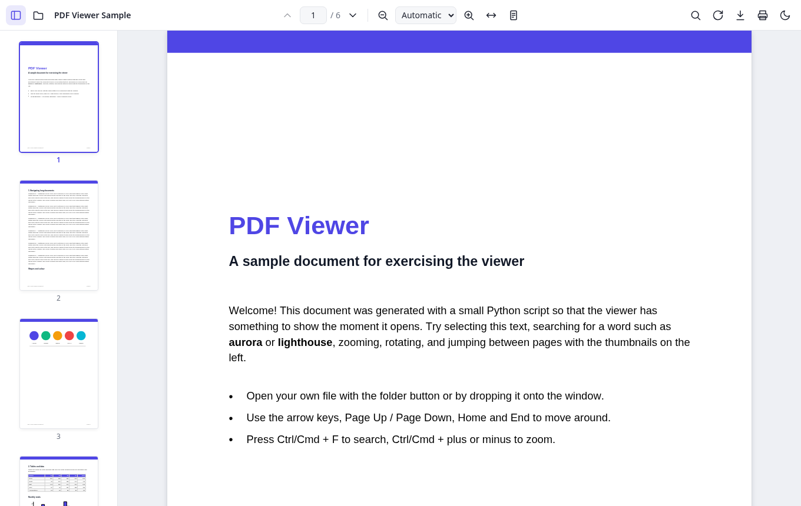

# PDF Viewer

A fast, clean, dependency-light PDF viewer that runs entirely in the browser. It is plain HTML, CSS and
JavaScript (ES modules) on top of [Mozilla PDF.js](https://mozilla.github.io/pdf.js/). There's no build
step and no framework, and nothing is uploaded: your files stay on your device.

**Live demo:** https://leofle.github.io/pdf-viewer/



## Features

- **Open PDFs** with the file picker, by dragging and dropping onto the window, or by URL with
  `?file=<url>` (for example `?file=samples/sample.pdf`). A sample document loads by default.
- **Continuous scrolling** with lazy rendering, so only visible pages (and their neighbours) are drawn.
- **Page navigation** with previous/next buttons, a page number box, thumbnails, and the keyboard.
- **Zoom**: in/out, presets from 50% to 400%, *Automatic*, *Fit width*, *Fit page*, *Actual size*, and Ctrl/⌘ + mouse
  wheel or trackpad pinch.
- **Selectable text** through the PDF.js text layer, so you can copy text from the document.
- **Search** with match count, find next/previous, highlighting of all matches, plus *match case* and *whole word* options.
- **Thumbnails sidebar** that renders lazily and follows the current page.
- **Rotate** pages clockwise (`R`) or counter-clockwise (`Shift+R`).
- **Download** the open document, or **print** it (pages are rendered at 150 DPI for printing).
- **Sign documents**: draw a signature (mouse, touch or pen pressure), type it in one of four handwriting fonts, or
  upload/paste a picture of it (the white background is made transparent). Place it on any page, then drag to move, use
  the corner to resize, duplicate or delete it, and copy/paste it between pages. Up to 12 signatures are saved in your
  browser for next time. *Download* and *Print* write the signatures into the PDF (as `<name>-signed.pdf`).
- **Dark mode** that follows your system setting by default; your choice is remembered.
- **Responsive**: on small screens the sidebar becomes an overlay and secondary actions move into a menu.
- Password-protected PDFs (you get a password prompt), internal links, and `#page=N` / `#zoom=` URL hashes.

### Keyboard shortcuts

| Keys | Action |
| --- | --- |
| `←` / `→` (or `K` / `J`) | Previous / next page |
| `Home` / `End` | First / last page |
| `Ctrl/⌘ + F` | Search (`Enter` next, `Shift+Enter` previous, `Esc` close) |
| `Ctrl/⌘ + +` / `−` / `0` | Zoom in / out / reset |
| `R` / `Shift + R` | Rotate clockwise / counter-clockwise |
| `S` | Signatures panel |
| `Delete` / arrows / `Ctrl/⌘ + C`, `V` | Remove / nudge (`Shift` for bigger steps) / copy & paste the selected signature |
| `Ctrl/⌘ + O` | Open a file |
| `Ctrl/⌘ + S` | Download |
| `Ctrl/⌘ + P` | Print |

## Run locally

The app is static, but ES modules and the PDF.js worker need to be served over HTTP (opening `index.html` with `file://`
won't work). Use any static server:

```sh
git clone https://github.com/leofle/pdf-viewer.git
cd pdf-viewer
python3 -m http.server 8000
# then open http://localhost:8000/
```

`npx serve .` works too.

### Opening remote PDFs

`?file=https://example.com/some.pdf` works only if that server allows cross-origin requests (CORS). Same-origin
paths such as `?file=samples/sample.pdf` always work.

## Project layout

```
index.html              App shell and toolbar
css/style.css           Styles (light/dark themes, responsive layout, print)
js/app.js               Viewer logic (loading, navigation, zoom, search, thumbnails, print…)
js/signatures.js        Signatures: create, save, place on pages, write into the PDF
vendor/pdfjs/           PDF.js 4.10.38 (pdfjs-dist), vendored: library, worker, viewer components
vendor/pdf-lib/         pdf-lib 1.17.1 (ESM build), used to write signatures into the PDF
vendor/fonts/           Handwriting fonts for typed signatures (from @fontsource)
samples/sample.pdf      Demo document
scripts/make_sample.py  Script that generates the demo document (needs `pip install reportlab`)
```

PDF.js is vendored, so the viewer and its web worker load from the same origin. That keeps it working on GitHub Pages
and offline. CMaps and standard font data (only some PDFs need them) are loaded from jsDelivr, pinned to the same
PDF.js version.

## Deploying

It's a static site. On GitHub Pages, select *Deploy from a branch → `main` / root*. Any other static host works the same way.

## License

[MIT](LICENSE) © L. Fleishman.

PDF.js is © Mozilla and contributors, licensed under the Apache License 2.0 (see `vendor/pdfjs/LICENSE`).
pdf-lib is © Andrew Dillon, MIT (see `vendor/pdf-lib/LICENSE.md`). Dancing Script, Great Vibes, Caveat and Sacramento are
licensed under the SIL Open Font License 1.1 (see `vendor/fonts/`).
